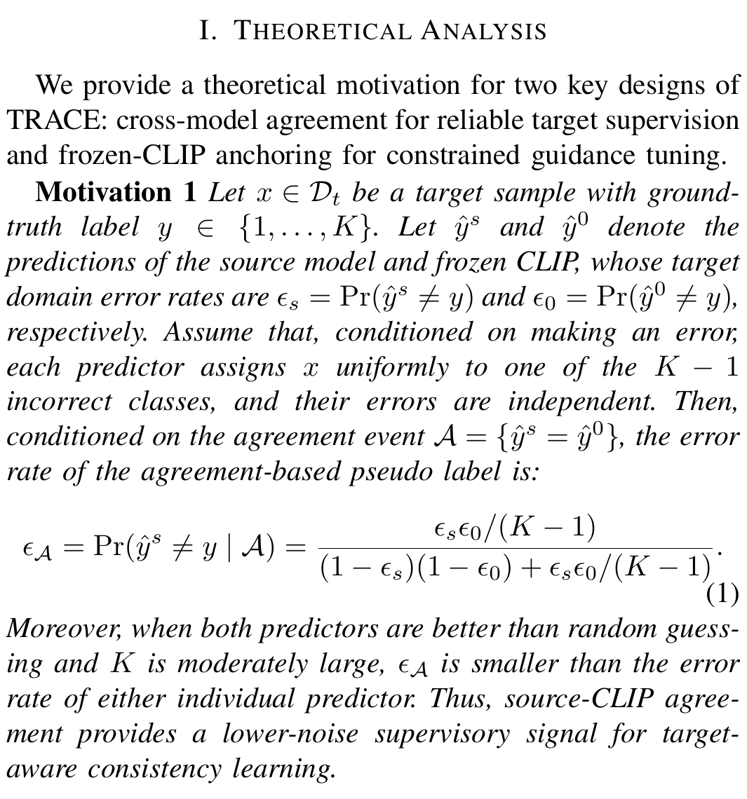
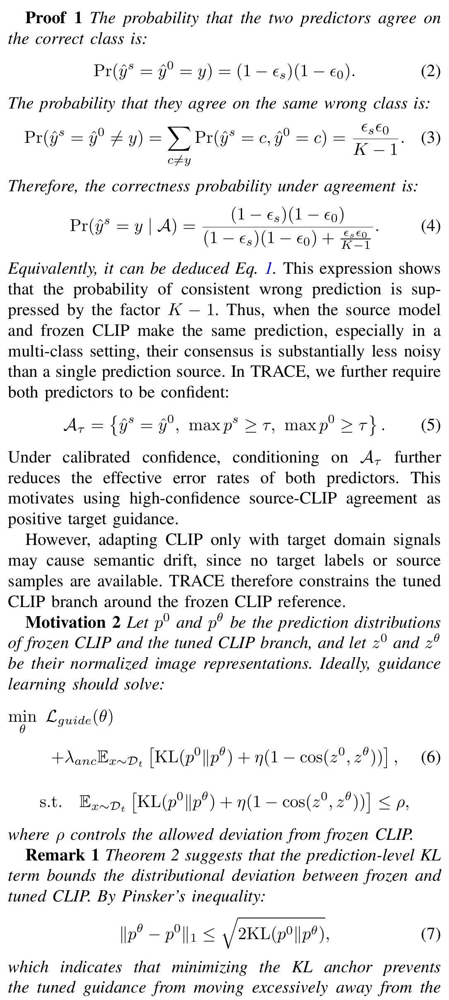
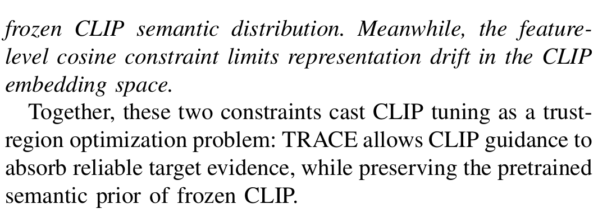
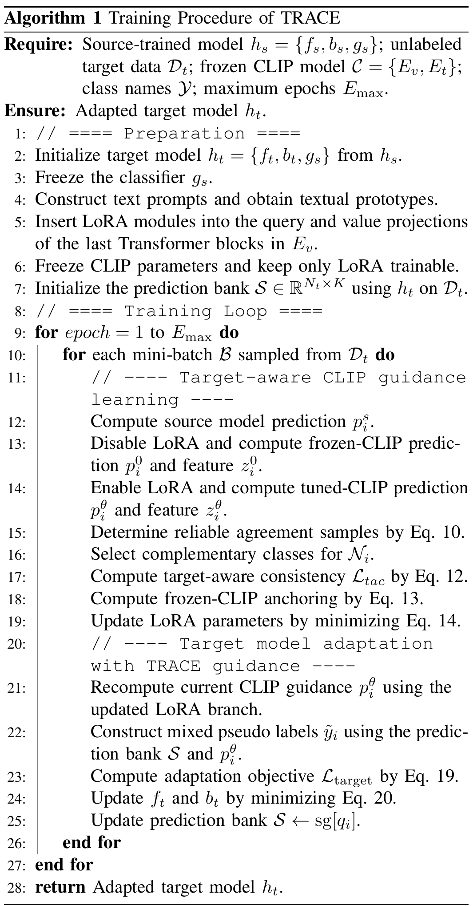

# TRACE-SFDA-Supplement
Supplementary material for paper "TRACE: Target Reliable Adaptive CLIP Enhancement via LoRA for Source-Free Domain Adaptation"

## Theoretical Analysis

## Algorithm 1: Training Procedure of TRACE

